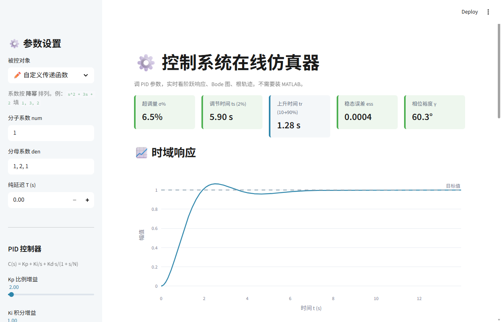

# ⚙️ control-lab · 控制系统在线仿真器

> 不用装 MATLAB，打开网页调 PID，实时看阶跃响应、Bode、Nyquist、根轨迹。


---

## 🤔 为什么做这个

自动控制原理的实验，几乎全靠 MATLAB + Simulink：

- MATLAB 正版 **两万块**，学生只能用破解版
- 破解版装在 20G 空间上，补丁被 Defender 反复拦
- 每次启动转半天，改个 Kp 要等一整套流程
- 手机、平板完全用不了，图书馆没电就没得调

**需求其实很简单**：给我一个滑块，我拖动，曲线立刻变。就这么点事，非得开 20G 的软件。

所以我用纯 numpy/scipy 重写了一套最小可用的控制系统工具，塞进网页里。

## 🖼 界面



左边拖滑块，右边曲线立刻变。五张指标卡一眼看全关键性能。

## ✨ 能做什么

| 功能 | 说明 |
|---|---|
| **PID 实时调参** | Kp / Ki / Kd / N 四个滑块，拖动即出图 |
| **时域响应** | 阶跃、脉冲、斜坡、正弦四种输入 |
| **性能指标** | 超调量、调节时间、上升时间、峰值时间、稳态误差，五张卡片一眼看全 |
| **Bode 图** | 幅频 + 相频双栏，标 0dB 与 -180° 参考线 |
| **Nyquist 图** | 含镜像段与 (-1, j0) 临界点标记 |
| **根轨迹** | k 从 0 扫描，画出闭环极点走向 |
| **稳定裕度** | 增益裕度、相位裕度、Bode 判据自动给结论 |
| **纯延迟** | 支持 e^(-Ts)，频域用精确相移，时域按时间平移 |
| **预设对象** | 一阶、二阶、三阶、双积分、不稳定、FOPDT、积分+延迟 |

## 🎓 内置我的课程实验模型

仓库里带了一个真实来源的模型——我本科《自动控制原理》实验做的直流电机调速：

```
被控对象  G(s) = 50 / (0.1s + 1)        ← 直流电机，增益 50，时间常数 0.1s
控制器    C(s) = Kp + Ki/s + Kd·s/(1+s/N)
          Kp = 3, Ki = 15, Kd = 0.05, N = 100
扰动      0.3（常值，接在 PID 输出与对象输入之间）
```

参数原样搬进预设里，选「⭐ 直流电机调速（课程实验原模型）」即可复现。

计算得到的结论（可与当年 Simulink 结果对照）：

| 指标 | 数值 |
|---|---|
| 闭环极点 | −4071, −33.4, −5.52（全部在左半平面） |
| 闭环稳定性 | 稳定 |
| 相位裕度 | 91.0° |
| 增益裕度 | ∞（相位只到 −90°，碰不到 −180°） |
| 稳态误差 | 0（积分环节作用） |

相位裕度 91° 说明这组 PID 整定得**非常保守**——很稳，但响应偏慢。想更快可以加 Kp、减 Ki 试试。

## 🚀 快速开始

```bash
pip install -r requirements.txt
streamlit run app.py
```

浏览器打开 `http://localhost:8501`。

## 🧱 项目结构

```
control-lab/
├── app.py                  # Streamlit 界面
├── ctrlkit/                # 核心库（不依赖 Streamlit，可单独 import）
│   ├── tf.py               #   传递函数代数：串联/并联/反馈/PID/Padé
│   ├── sim.py              #   时域仿真：scipy 精确解 + 延迟处理 + 性能指标
│   ├── freq.py             #   频域分析：Bode / Nyquist / 根轨迹 / 裕度
│   └── presets.py          #   预设对象（含课程实验模型）
├── tests/
│   └── test_ctrlkit.py     # 37 个单元测试
└── requirements.txt
```

**`ctrlkit` 是独立库**，不装 Streamlit 也能用：

```python
from ctrlkit import TF, pid, simulate, metrics, margins

G = TF([50], [0.1, 1])          # 50/(0.1s+1)
C = pid(3, 15, 0.05, 100)       # PID with derivative filter
L = C * G                       # 开环
phi = L.feedback()              # 闭环

t, y, u = simulate(phi, t_end=1.0, input_type="step")
print(metrics(t, y, target=1.0))
print(margins(L))
```

## 🧪 测试

```bash
python -m pytest tests/ -v
```

**37 个测试全部通过**，覆盖：

- 传递函数代数：串联/并联/反馈/零极点/稳定性/直流增益
- PID：P / PI / PID / 带滤波微分 / 全零边界
- Padé 逼近：一阶精度、直流增益恒为 1
- 时域仿真：一阶终值与时间常数、二阶超调与解析解对比、脉冲响应积分面积、延迟移位、不稳定发散
- 频域：积分器 −20dB/dec 斜率、一阶 −3dB 拐点与 −45° 相位、延迟相移
- 裕度：相位裕度计算、无穿越时的 nan 处理
- 根轨迹与 Nyquist 数据结构

**关键设计**：每一步都用**解析解**做参照，不是自己验证自己。

## 🔬 两个值得一提的技术处理

### 1. 刚性系统的数值稳定

第一步用 RK4 定步长，遇到这个模型直接爆了：

```
闭环极点 -4071 rad/s ≈ 时间常数 0.25 ms
仿真时长 20 s，步长 0.001 s
→ 步长比系统最快动态还慢 4 倍，积分发散
```

改用 `scipy.signal.lsim` 的**零阶保持矩阵指数解**，对该问题无条件稳定。

### 2. 脉冲响应的精确注入

用窄矩形近似脉冲，面积总是少一半（离散化只覆盖左端点）。改成**状态跳变**：

$$x(0^+) = x(0^-) + B \cdot A_{imp}$$

与步长完全无关，面积精确为 1。

### 3. 延迟的处理也不能偷懒

频域用**精确相移** $e^{-j\omega T}$（不是 Padé 近似），时域按时间平移后重采样。两边都不失真。

## ⚠️ 已知限制

- **单输入单输出**，多变量系统（状态空间 MIMO）不支持
- **线性时不变**，非线性环节（饱和、死区、滞环）没有
- **连续系统**，离散控制（Z 变换、采样保持）没做
- 延迟只是**纯延迟**，分布延迟不支持
- 根轨迹按 `np.roots` 顺序连线，极点靠得很近时分支可能跳线

这些都在路线图里，但考研前不打算动。

## 🗺 路线图

- [x] 传递函数代数与 PID
- [x] 时域仿真（四种输入）+ 性能指标
- [x] Bode / Nyquist / 根轨迹 / 稳定裕度
- [x] 纯延迟支持
- [x] 课程实验模型预设
- [x] 37 个单元测试
- [ ] 在线部署（Streamlit Cloud）
- [ ] 状态空间 MIMO 支持
- [ ] 非线性环节（饱和、死区）
- [ ] 离散系统与 Z 域分析
- [ ] 参数自动整定（Ziegler-Nichols / 内模法）
- [ ] 导出仿真数据为 CSV

## 📮 联系

- QQ 邮箱：`264589301@qq.com`
- 欢迎 Star ⭐ 与 Issue

---

*考研间隙写的。写完发现自己复习自控的时候确实方便了不少——不用开 MATLAB 就能验证手算的题。* 🌱
